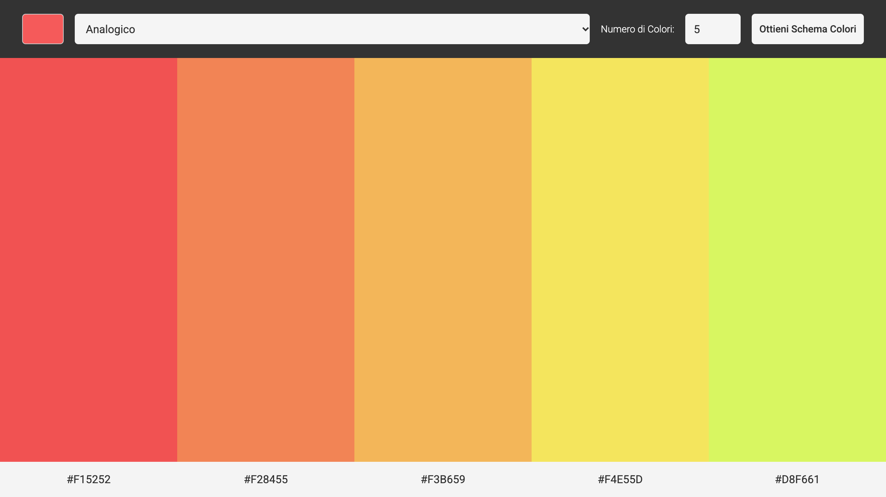
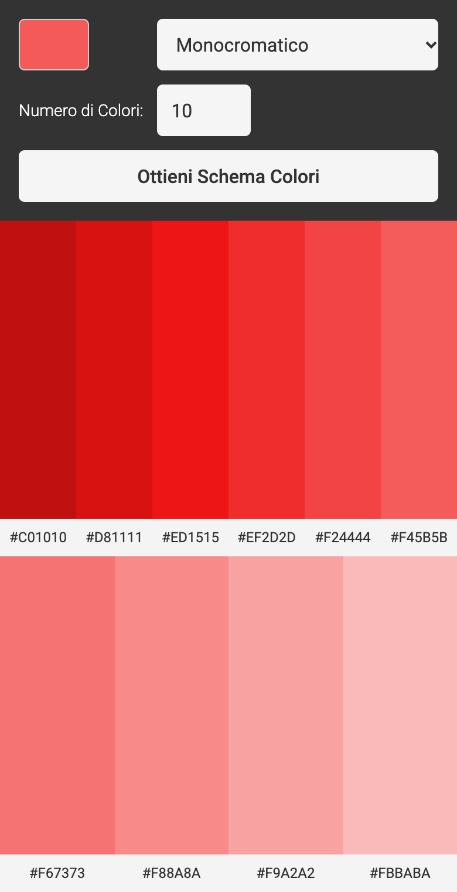

# 🎨 Color Scheme Generator

> Scegli un colore, scegli uno schema, e ricevi in un attimo una palette armonica pronta da copiare.
> Il mio **primo progetto con `fetch()` e una API REST reale**.


<p align="center">
  
  &nbsp;
  
</p>

🔗 **Live demo:** _(aggiungi qui il link a GitHub Pages / Netlify)_

---

## ✨ Cosa fa

- 🎯 **Colore di partenza** a scelta con il selettore nativo `input type="color"`
- 🧭 **8 tipi di schema**: Monocromatico, Monocromatico scuro, Monocromatico chiaro, Analogico, Complementare, Analogico complementare, Triade, Quad
- 🔢 **Numero di colori personalizzabile** (da 1 a 10), con validazione nativa del browser
- 📋 **Copia con un click**: clicchi un codice hex → finisce negli appunti e la scritta diventa *"Copied!"* per 2 secondi
- ⚡ **Palette già pronta all'apertura**: la prima richiesta parte al caricamento della pagina
- 📱 **Responsive mobile first**: navbar su 3 righe su telefono, su una riga da tablet in su; con molti colori la palette va a capo da sola

---

## 🌐 La parte API: come funziona

Il cuore del progetto è la comunicazione con **[The Color API](https://www.thecolorapi.com/docs#schemes)**, una API REST pubblica e gratuita che restituisce dati in **JSON**.

### Il flusso completo

```
 Utente                     Browser (JS)                         The Color API
   │                             │                                     │
   │ sceglie colore, schema,     │                                     │
   │ numero e clicca il bottone  │                                     │
   ├────────────────────────────►│                                     │
   │                             │ 1. FormData legge i valori del form │
   │                             │ 2. costruisce l'URL (query string)  │
   │                             │ 3. fetch(url) → GET                 │
   │                             ├────────────────────────────────────►│
   │                             │                                     │
   │                             │◄──────────── Response (JSON) ───────┤
   │                             │ 4. res.json() → oggetto JS          │
   │                             │ 5. .map() → HTML per ogni colore    │
   │                             │ 6. .join("") → innerHTML            │
   │◄────────────────────────────┤                                     │
   │  vede la palette            │                                     │
```

### L'endpoint

| Parte | Valore |
|---|---|
| **Metodo** | `GET` (il default di `fetch`) |
| **Base URL** | `https://www.thecolorapi.com` |
| **Endpoint** | `/scheme` |
| **Query string** | `?hex=F55A5A&mode=monochrome&count=5` |

| Parametro | Da dove arriva | Nota |
|---|---|---|
| `hex` | `input type="color"` | il browser restituisce `#f55a5a` → tolgo il `#` con `.slice(1)` perché l'API lo vuole senza |
| `mode` | `<select>` | il `value` di ogni `<option>` è scritto esattamente come lo vuole l'API (`monochrome-dark`, `analogic-complement`...) |
| `count` | `input type="number"` | limitato da `min="1"` e `max="10"` |

### La richiesta nel codice

Il codice è diviso in **due funzioni con un compito ciascuna**: una chiede i dati all'API, l'altra disegna la palette.

```js
// 1️⃣ Chiede i dati all'API
function fetchColor() {
    // Leggo i valori del form nel momento della richiesta
    const formData = new FormData(form)
    const colorSelected = formData.get("color")
    const scheme = formData.get("scheme")
    const count = formData.get("count")

    // Costruisco l'URL con una template string e faccio la richiesta
    fetch(`https://www.thecolorapi.com/scheme?hex=${colorSelected.slice(1)}&mode=${scheme}&count=${count}`)
        .then(res => res.json())          // il body della risposta → oggetto JS
        .then(data => {
            try {
                renderColors(data.colors)  // passo solo l'array dei colori
            } catch (err) {
                colorsContainer.innerHTML = `<p>Impossibile mostrare la palette, riprova più tardi.</p>`
            }
        })
}

// 2️⃣ Disegna la palette con i dati ricevuti
function renderColors(colorArray) {
    colorsContainer.innerHTML = colorArray.map((color) => {
        return `
            <div class="single-color-cnt">
                <div class="color-box" style="background-color: ${color.hex.value}"></div>
                <p data-hex="${color.hex.value}">${color.hex.value}</p>
            </div>`
    }).join("")
}
```

- `fetchColor()` parte **al caricamento** della pagina e a **ogni submit** del form
- I dati passano da una funzione all'altra come **argomento**: passo solo l'array che serve (`renderColors(data.colors)` → parametro `colorArray`), perché `renderColors` non può vedere le variabili create dentro il `.then`
- Se il disegno della palette va in errore, il `try...catch` mostra un messaggio invece di lasciare la pagina vuota

### Cosa risponde l'API (semplificato)

```json
{
  "mode": "monochrome",
  "count": "5",
  "colors": [
    { "hex": { "value": "#C01010", "clean": "C01010" }, "rgb": { }, "name": { } },
    { "hex": { "value": "#ED1515", "clean": "ED1515" }, "rgb": { }, "name": { } }
  ],
  "seed": { "hex": { "value": "#F55A5A", "clean": "F55A5A" } }
}
```

Mi serve solo l'array `colors`: per ogni elemento leggo `hex.value` e lo uso **due volte**, come colore di sfondo e come testo.

---

## 📋 Copia negli appunti con event delegation

I `<p>` con i codici **non esistono** quando la pagina si carica: li crea il JS dopo ogni risposta, e vengono ricreati a ogni nuova richiesta. Per questo non metto un listener su ognuno, ma **un solo listener sul contenitore della palette** (che esiste sempre) e controllo cosa è stato cliccato:

```js
colorsContainer.addEventListener("click", (e) => {
    if (e.target.dataset.hex) {                    // ho cliccato un codice hex?
        const hexCode = e.target.dataset.hex       // il valore originale resta nel data-attribute
        navigator.clipboard.writeText(hexCode)
        e.target.textContent = "Copied!"
        setTimeout(() => {
            e.target.textContent = hexCode         // dopo 2s torna il codice
        }, 2000)
    }
})
```

Il valore sta nell'attributo `data-hex` così, anche quando il testo diventa *"Copied!"*, il codice originale resta disponibile.

---

## 📐 Layout responsive

- **Mobile first** con **CSS Grid** e `grid-template-areas`: il layout della navbar si legge direttamente nel CSS
  ```css
  /* telefono */                    /* da 600px in su */
  grid-template-areas:              grid-template-areas:
      "color  scheme"                   "color scheme label count button";
      "label  count"
      "button button";
  ```
- Tutti i campi alti **44px** (area di tocco consigliata) e `font-size: 1rem`, così Safari su iPhone non fa zoom quando li tocchi
- Palette in **Flexbox**: `flex: 1` divide lo spazio in parti uguali per qualsiasi numero di colori; `flex-wrap` + `min-width` mandano a capo le colonne quando diventano troppo strette
- Swatch del color picker a tutto riquadro con `::-webkit-color-swatch`

---

## 🧠 Cosa ho imparato

- **API e REST**: client/server, request/response, base URL + endpoint, query string
- **`fetch()` e Promise**: la catena `.then()`, perché servono due `.then`, cosa fa `res.json()`
- **JavaScript asincrono**: i dati esistono solo dentro il `.then`, non prima
- **Leggere la documentazione** di una API e ispezionare la risposta con `console.log` per capire la struttura dei dati
- **`FormData`** e l'attributo `name`, letti nel momento giusto (dentro la funzione, non al caricamento)
- **Scope** e **parametri vs argomenti**: perché una variabile creata in una funzione non si vede in un'altra, e come passargliela
- **Refactoring**: dividere il codice in funzioni con un solo compito e nomi onesti
- **`try...catch`** dentro il `.then`, per gestire un errore senza bloccare la pagina
- **`.map()` + `.join("")` + template string** per generare HTML dinamico
- **Event delegation**, `e.target` e i **data attributes**
- **Stringa vs elemento del DOM**: `textContent` funziona solo sugli elementi
- **Responsive mobile first** con Grid areas e media query `min-width`

---

## 🚀 Prossimi passi

- [ ] Gestione degli errori con `.catch()` e controllo di `res.ok` (messaggio all'utente se l'API non risponde)
- [x] Refactoring: separare la richiesta all'API dal rendering della palette
- [x] `try...catch` sul rendering della palette
- [ ] Riscrivere la richiesta con `async/await`
- [ ] Mostrare "Copied!" solo dopo la conferma della Promise di `navigator.clipboard`
- [ ] Tema chiaro/scuro come nel design originale

---

## ▶️ Provalo in locale

Nessuna dipendenza e nessuna build:

```bash
git clone <url-del-repo>
cd color-scheme-generator
```

Poi apri `index.html` nel browser (o usa l'estensione **Live Server** di VS Code).

> ℹ️ La copia negli appunti usa la Clipboard API, che alcuni browser permettono solo su `https` o `localhost`: con Live Server o online funziona sicuramente.

---

## 🙏 Crediti

- Progetto dal percorso **Frontend Developer di [Scrimba](https://scrimba.com)**, sul design Figma fornito dal corso
- Dati dei colori: **[The Color API](https://www.thecolorapi.com)**

---

👤 **Matteo Campelli** — frontend developer in formazione
